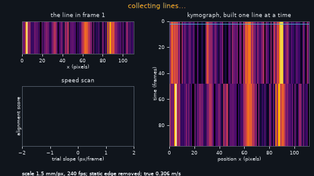
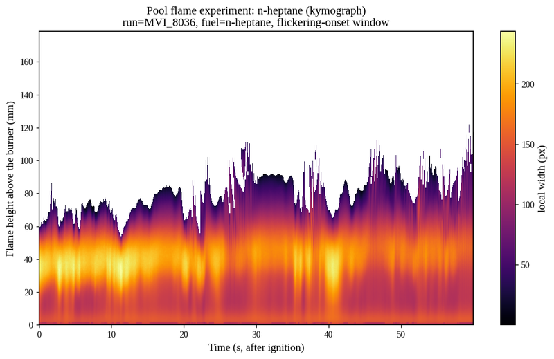
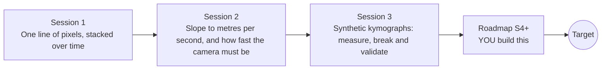

# openkymo

[](https://github.com/KrunalPanchal1995/openkymo/actions/workflows/ci.yml)   [](https://colab.research.google.com/github/KrunalPanchal1995/openkymo/blob/main/sessions/session-01/lesson.ipynb) [](https://krunalpanchal1995.github.io/openkymo/)

**Turn a video into one picture and read speed off its stripes, in three sessions.**

openkymo teaches how to stack one line of pixels from every video frame into a kymograph and measure flow speed from the slope of its stripes, using only Python and a browser.

- **Start from zero.** Session 1 needs only a ruler-and-stopwatch idea of speed; the kymograph is built step by step.
- **See it move.** Every session ships a slider app that runs in the browser, with labelled graphs.
- **Know you got it right.** Each session ends with a checkpoint that prints PASS or FAIL against hand calculations.
- **Build the missing half.** The repo stops at Session 3 on purpose; the roadmap shows the path to the Target.

[Target](#the-target) · [Who is this for](#who-is-this-for) · [Quick start](#quick-start) · [Sessions](#sessions) · [Roadmap](#roadmap) · [Contribute](#contribute) · [Explainer PDF](docs/explainer.pdf)

> **This repo is incomplete on purpose.** Sessions 1 to 3 are here and fully working. The finished Target below is a preview of what the community can build next. We show you the path, not the code. Sessions 4 and up are yours.

## The Target

A kymograph is built line by line while you watch. On the left, a strip of the video shows several bright patches carried along by a flow, with a stationary bright edge that must be ignored. On the right, the kymograph grows one row per frame; as soon as the stripes are long enough, a fitted line appears over each of them, and a small speed-scan graph shows a single sharp peak. A readout gives the slope in pixels per frame and the flow speed in metres per second. Your goal over the coming sessions: build that measurement yourself.



*Target: a kymograph built line by line, with fitted slopes and a speed readout*

- [Math Visual Studio: the kymograph, stripe slope is convection speed (video)](promo/media/studio_kymograph.mp4)

- [Math Visual Studio: aliasing in time-sampled images (video)](promo/media/studio_aliasing.mp4)



*A kymograph from a real flame video (flamelab project)*

Try it live:

- [Math Visual Studio: the kymograph, stripe slope is convection speed (Atlas S116)](https://krunalpanchal1995.github.io/studio/#atlas?ch=S116&ex=1)

How the Target was made is shown only as a path in [promo/roadmap.md](promo/roadmap.md).

## Who is this for
**higher secondary to advanced undergraduate (levels 4-6).** Topic area: Statistics, Research and Experimental Methods.

Prerequisites:

- Speed as distance divided by time, and the slope of a straight-line graph (school level).
- Python 3.10 or newer; if `python --version` works, you are ready. PRIMER.md explains the rest.
- No prior GitHub, image-processing or video experience is needed.

New to Python? Read [PRIMER.md](PRIMER.md) first (10 minutes).

## Quick start

No installation knowledge needed. You need [Git](https://git-scm.com/downloads) and [Python 3.10+](https://www.python.org/downloads/) (Windows: tick "Add Python to PATH"). On Mac and Linux type `python3` wherever this page says `python`.

```bash
git clone https://github.com/KrunalPanchal1995/openkymo.git
cd openkymo
python start.py 1
```

`start.py` creates a private environment, installs what is needed and runs Session 1 with its checkpoint. Next: `python start.py 2`, `python start.py 3`, or `python start.py test` to check everything. Only a checkpoint: `python start.py check 1`.

Four lines turn the idea of Session 1 into a result (they work as they are): Save it as `try.py` and run it with `python start.py run try.py` (this uses the private environment, where NumPy is installed):

```python
import numpy as np
t = np.arange(40)                                    # 40 frames
x = np.arange(64)
K = np.exp(-(x[None, :] - (8 + 0.6 * t[:, None])) ** 2 / 8)   # kymograph: a blob moving 0.6 px per frame
print(np.argmax(K, axis=1)[[10, 30]], 'slope =', (np.argmax(K[30]) - np.argmax(K[10])) / 20, 'px/frame')   # -> [14 26] slope = 0.6
```

Every session also opens in your browser with sliders (no install): [live apps](https://krunalpanchal1995.github.io/openkymo/). Or use the Colab badge above for the notebook.

## Sessions

| # | Session | Model level | Time | Live app |
|---|---|---|---|---|
| 1 | [One line of pixels, stacked over time](sessions/session-01/README.md) | Level 1: conceptual interactive model | 60 min | [open](https://krunalpanchal1995.github.io/openkymo/session-01/) |
| 2 | [Slope to metres per second, and how fast the camera must be](sessions/session-02/README.md) | Level 2: mathematical engineering model | 75 min | [open](https://krunalpanchal1995.github.io/openkymo/session-02/) |
| 3 | [Synthetic kymographs: measure, break and validate](sessions/session-03/README.md) | Level 3: simulation and validation | 90 min | [open](https://krunalpanchal1995.github.io/openkymo/session-03/) |

Each session follows the same six steps: A real-world problem, B concept and theory, C visual explanation, D interactive simulation, E worked example and experiment, F assessment and design challenge. Each ends with `checkpoint.py`, which prints `PASS` or `FAIL` against reference numbers. Session 3 also contains the real-world mini-project: **Measure the speed of a conveyor belt from a kymograph**.

## Architecture



| Folder or file | What is inside |
|---|---|
| `sessions/` | three sessions: README (A-F), `lesson.py`, notebook, live app, exercises, activity sheet, checkpoint |
| `promo/` | the Target: media, live links, and the roadmap (path only) |
| `docs/` | `explainer.tex` and the built `explainer.pdf` |
| `tests/` | runs every lesson and checkpoint headless |
| `start.py` | one command to set up and run anything |
| `QUALITY.md`, `RUBRIC.md` | the quality checklist and the scoring rubric |
| `.github/` | CI, PDF build, Pages deploy, issue and PR templates |

## Roadmap

| Milestone | What you will build | Difficulty |
|---|---|---|
| Session 4: Moving versus static stripes | A function that separates the moving stripes from the static ones before measuring. | intermediate |
| Session 5: Stripes in both directions | An estimator that returns every dominant velocity, not only one. | intermediate |
| Session 6: Beat the noise | A line-integral (Radon or shear-sum) speed estimator and its Monte Carlo study. | advanced |
| Session 7: Unwrap an aliased speed | A routine that uses two sub-sampled versions of the same data to find the true shift. | advanced |
| Session 8: A falling drop: speed along a curved stripe | A function that returns the local speed at every frame without hand-picked windows. | advanced |

Full detail with a checkpoint per milestone: [promo/roadmap.md](promo/roadmap.md).

## Contribute
New to GitHub? Read [CONTRIBUTING.md](CONTRIBUTING.md); it starts from zero. Pick an issue labelled `good first issue`. Translations into Hindi, Telugu, Tamil and Malayalam are welcome.

<details>
<summary>Development</summary>

```bash
python start.py test        # runs every lesson and checkpoint
```
Lessons use `# %%` cell markers so they open as notebooks in VS Code. See [QUALITY.md](QUALITY.md) for the standard every session meets.
</details>

## License
MIT. See [LICENSE](LICENSE). Media in `promo/media` is (c) Krunal Panchal, CC BY 4.0.

## Acknowledgments
Part of the [PAN IIT OSS](https://hellofoss.tech-iitb.org/projects) open-source teaching collection, modelled on the structure of [openspline](https://github.com/openspline/openspline). Built on ideas from the Math Visual Studio at https://krunalpanchal1995.github.io/studio/.
