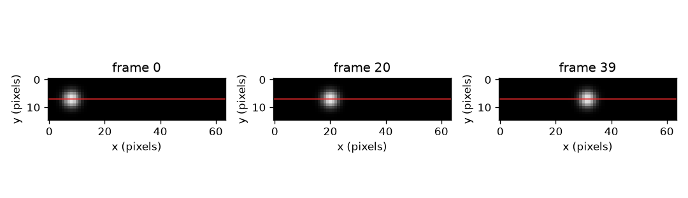
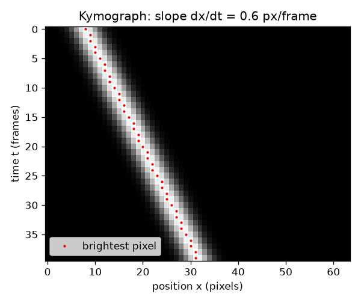

# Session 1: One line of pixels, stacked over time

*Level 1 (conceptual interactive model) · about 60 minutes · openkymo*

> This is a simplified educational model. It is not a validated design tool and must not be used for real structures, electrical installations, vehicles, industrial processes or medical decisions.

**Prerequisites**

- Speed = distance / time and the slope of a graph (school level).
- You have read PRIMER.md and run `python start.py 1` once.

**Learning objectives.** After this session you can:

- Build a kymograph by stacking one row of pixels from every video frame.
- Explain why a moving object makes a slanted stripe and a still object a vertical one.
- Measure the stripe slope in pixels per frame, from two points and from a line fit.
- Read the same motion from a position-against-time graph and from the kymograph.

## A. Real-world problem
A bead rolls along a tube, a drop falls past a window, a bright patch rides on a flame. A video shows that things move, but a video is hard to measure: thousands of frames, each one a full picture. What if you kept only one line of pixels from each frame and stacked those lines into a single image? Then a whole video becomes one picture, and the speed becomes something you can read with a ruler: the slope of a stripe.

## B. Concept and theory
A video is a stack of frames. Each frame is a grid of brightness numbers. Choose one row of the grid (the line) and cut that row out of every frame. Stack the cut-out rows with frame 0 at the top: you get a new image called a kymograph. Its columns are positions along the line (pixels) and its rows are time (frames). If a bright blob sits at pixel x0 in frame 0 and moves v pixels in every frame, it is at x0 + v t in frame t, so in the kymograph it draws a straight stripe. The slope of that stripe, dx/dt, is the speed v in pixels per frame. A still object has v = 0 and makes a vertical stripe. A faster object makes a stripe that is tilted further from vertical. Section B of Session 2 turns pixels per frame into metres per second.

| Symbol | Meaning | Unit |
|---|---|---|
| t | frame number (time, counted from 0) | frames |
| x | position along the chosen line | pixels |
| x0 | blob position in frame 0 | pixels |
| v | speed of the blob = slope of the stripe dx/dt | pixels per frame |
| K(t, x) | kymograph brightness at row t and column x | brightness units |

**Assumptions**

- The object moves along the chosen line (or the line is placed along the motion).
- The speed is constant while we measure.
- The camera does not move and the frames are taken at equal time steps.

$$ x(t)=x_0+v\,t $$

$$ v=\frac{x_2-x_1}{t_2-t_1}=\frac{\Delta x}{\Delta t} $$

$$ K(t,x)=\text{frame}_t[\text{row},\,x] $$

## C. Visual explanation
The first figure shows three frames of a small video (frame 0, 20 and 39) with the chosen line drawn in red: the blob sits further right in each. The second figure is the kymograph made from that line. It has 40 rows (frames) and 64 columns (pixels), and the bright stripe runs from the left at the top to the right at the bottom. The red dots mark the brightest pixel in every row; they lie on a straight line whose slope is 0.6 pixels per frame.

*Three frames of a tiny video; the red line is the row that is stacked into the kymograph.*

*The kymograph: time down, position across. The red dots lie on a straight line of slope 0.6 px/frame.*

## D. Interactive simulation
Run the lesson (`python start.py 1`), then open the live app: [Session 1: build a kymograph](https://krunalpanchal1995.github.io/openkymo/session-01/) (or `app.html` in this folder). Move the speed slider and watch the stripe tilt, then switch to the position graph and see the same motion as a straight line against time. Try a negative speed and a speed of zero.

**Challenge.** Make the blob start in the left part of the line (x0 at most 12) and be beyond pixel 56 by frame 39.

## E. Worked example and experiment
**Problem.** In the video of Figure 1 the blob moves at 0.6 px/frame from x0 = 8. Find its column in frames 10 and 30 and the slope between them.

1. Position in frame 10: 8 + 0.6 * 10 = 14.
2. Position in frame 30: 8 + 0.6 * 30 = 26.
3. Slope = (26 - 14) / (30 - 10) = 12 / 20 = 0.6 px/frame.
4. Sanity check: over 39 frames the blob moves 0.6 * 39 = 23.4 pixels, from 8 to 31.4, well inside the 64 pixel line.

**Answer.** The blob is at column 14 in frame 10 and column 26 in frame 30; the stripe slope is 0.6 px/frame.

**Experiment.** Roll a coin or a marble along a table past a phone camera, with the phone fixed on a book. Extract one row of pixels from every frame (a free video tool or a short script) and stack them. Measure the stripe slope in pixels per frame, then compare with distance divided by time from a ruler and the video timestamps. Differences come from the lens (objects nearer the edge look smaller), from the object not moving exactly along the line, and from reading a stripe edge by eye: the model assumes a perfect straight line and equal frame spacing.

## F. Assessment and design challenge
**Question type A: Conceptual.** What does a vertical stripe mean? What would a bright horizontal stripe (the same row lit up in a single frame) mean?

Hint

Time runs down the picture and position runs across.

Step-by-step solution

A vertical stripe stays at the same column in every frame, so the object does not move. A horizontal stripe lies in one row only, i.e. in a single frame, and covers many columns: the whole line lit up at the same moment, such as a flash of light or an object so fast that it crosses the whole line within one frame. It is not a sign of a moving object that can be measured.

**Question type B: Numerical.** A blob is at column 5 in frame 0 and at column 41 in frame 30. Find its speed in px/frame and check that it stays on a 64 pixel line for 40 frames.

Hint

Speed = change in position divided by change in frame number.

Step-by-step solution

Speed = (41 - 5) / 30 = 1.2 px/frame. In 40 frames it travels 1.2 * 40 = 48 pixels, from 5 to 53, which is inside 64 pixels, so it stays on the line. Unit: pixels per frame.

**Question type C: Graph and simulation interpretation.** In the app, how does the stripe look in the kymograph and how does the line look in the position graph when you triple the speed from 0.3 to 0.9? Which picture shows the faster object as steeper?

Hint

Compare which axis is time in each picture.

Step-by-step solution

In the position graph time is the horizontal axis, so tripling the speed triples the slope: a steeper line (0.9 against 0.3 pixels per frame). In the kymograph time runs downwards, so the stripe becomes flatter, further tilted from vertical: it covers three times as many columns for each row. Same motion, different axes.

**Question type D: Design and optimisation challenge.** Design: the line is 64 pixels long, the blob starts at pixel 8, and you want it to stay on the line for at least 30 frames while you measure. Which speeds are allowed? Why would a very slow blob also be a poor choice?

Hint

The blob must still be on the line at frame 30, so 8 + 30 v is below the last pixel; think about how many pixels of motion a slope fit has to work with.

Step-by-step solution

Stay below pixel 56 (leave a margin of about 7 pixels) at frame 30: 8 + 30 v <= 56 gives v <= 1.6 px/frame. A very slow blob, say 0.05 px/frame, moves only 1.5 pixels in 30 frames, less than a blob width, so the slope is hard to read against pixel rounding. A useful range is about 0.2 to 1.6 px/frame. Trade-off: a faster blob uses the line up sooner, a slower one gives a less accurate slope.

Score yourself with [RUBRIC.md](../../RUBRIC.md). Print the [activity sheet](activity_sheet.md) to work on paper.

## Common misconceptions
| Common misconception | What is actually true |
|---|---|
| The kymograph is a picture of the object. | It is a picture of one line over time. The vertical axis is time, not space; the object only appears as a stripe. |
| A steeper stripe means a faster object. | That depends on the axes. With time running down (as here) a faster object gives a stripe tilted further from vertical; a vertical stripe is the slowest of all, speed zero. |
| The speed of the stripe is in metres per second. | The slope read from the picture is in pixels per frame. To get metres per second you need the pixel size and the frame rate (Session 2). |
| One kymograph shows motion in the whole video. | It shows motion only along the chosen line; motion across the line or away from it is not measured. |

## Glossary
- **kymograph**: an image made by stacking the same line of pixels from every frame; position across, time down
- **frame**: one picture of the video, taken at one moment
- **pixel**: one tiny square of an image with one brightness value
- **stripe**: the bright track of a moving object in a kymograph
- **slope**: how far the stripe moves across (pixels) per step down (frames)

## Finish
1. Do the three coding tasks in [exercises.md](exercises.md).
2. Run `python start.py 1` again after your changes. It ends with the checkpoint; when it prints `PASS`, you are done. (Checkpoint only: `python start.py check 1`.)

Next: [Session 2](../session-02/README.md)
