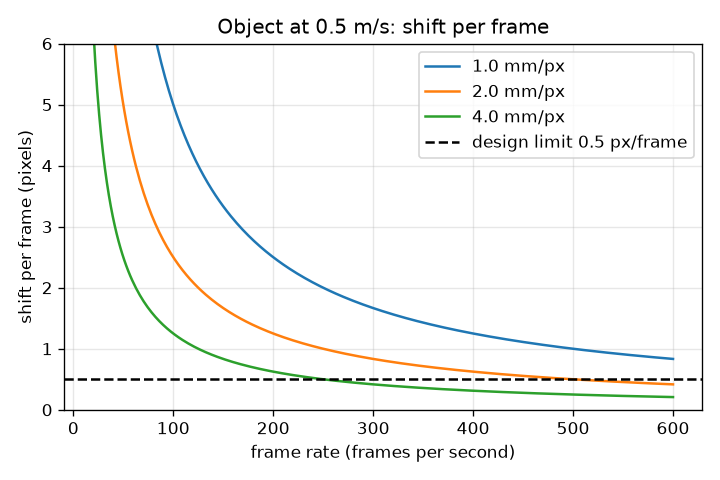
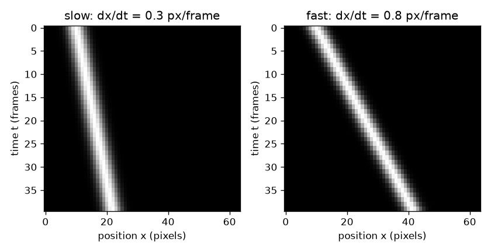

# Session 2: Slope to metres per second, and how fast the camera must be

*Level 2 (mathematical engineering model) · about 75 minutes · openkymo*

> This is a simplified educational model. It is not a validated design tool and must not be used for real structures, electrical installations, vehicles, industrial processes or medical decisions.

**Prerequisites**

- Session 1: kymograph and stripe slope.
- Derivatives as slopes; the idea of a 2x2 matrix helps but is explained in Section B.

**Learning objectives.** After this session you can:

- Convert a stripe slope in pixels per frame into metres per second using pixel size and frame rate.
- Estimate the slope from image gradients with the structure tensor and read its coherence.
- Relate the slope to the stripe angle, tan(angle) = v.
- Solve the design problem: choose the frame rate (or pixel size) so that the shift per frame stays small enough.

## A. Real-world problem
An engineer asks: how fast does the air move in this flame, or how fast is the belt going? A slope of 0.8 pixels per frame is not an answer. We need the size of a pixel on the real object, the number of frames per second, and a way to measure the slope using every pixel of the stripe, not two hand-picked points. And before filming, we must choose the camera settings so that the measurement can work at all.

## B. Concept and theory
A pattern that moves rigidly has brightness K(t, x) = f(x - v t). Differentiating gives Kt + v Kx = 0, where Kx is the brightness change per pixel and Kt per frame. Every pixel gives one such equation. The structure tensor J collects the sums of Kx Kx, Kx Kt and Kt Kt over the whole image into a 2x2 matrix. Its eigenvector for the larger eigenvalue (nx, nt) is the direction in which brightness changes fastest, which is across the stripes. The stripes run perpendicular to it, so v = -nt / nx. The coherence (big minus small eigenvalue over their sum) is close to 1 when the stripes are clean and parallel. In real units: one pixel covers a size dx on the object (millimetres, divided by 1000 for metres) and the camera takes fps frames each second, so speed in m/s = slope * dx * fps. The method assumes the pattern moves only a small fraction of its own width between frames. A safe rule for a blob is a shift per frame of at most 0.5 pixel (and never above 1 pixel). The shift per frame is v / (dx fps), so the slowest allowed frame rate is fps_min = v / (0.5 dx), and the line must be at least shift * n_frames pixels long to hold a stripe for n_frames frames.

| Symbol | Meaning | Unit |
|---|---|---|
| v_px | stripe slope | pixels per frame |
| dx | size of one pixel on the object (mm per pixel, divided by 1000 for m) | mm/px |
| fps | frame rate of the camera | frames per second |
| v | speed of the object | m/s |
| Kx, Kt | brightness change per pixel and per frame | brightness units per pixel, per frame |
| J | structure tensor, 2x2 matrix of summed products of gradients | brightness units squared |
| nx, nt | components of the main eigenvector of J | no unit |
| shift | pixels moved between two frames = v_px | pixels per frame |

**Assumptions**

- Rigid motion: the pattern slides without changing shape.
- Pixels are square and the object moves along the line; no lens distortion.
- The shift per frame is small compared with the feature size (the safe rule above is a conservative guide; Session 3 measures where the method really breaks).
- Frames are equally spaced in time.

$$ K(t,x)=f(x-vt)\;\Rightarrow\;K_t+v\,K_x=0 $$

$$ J=\begin{pmatrix}\sum K_xK_x & \sum K_xK_t\\ \sum K_xK_t & \sum K_tK_t\end{pmatrix},\qquad v=-\frac{n_t}{n_x} $$

$$ v_{\mathrm{m/s}}=v_{\mathrm{px}}\cdot\frac{\mathrm{mm/px}}{1000}\cdot \mathrm{fps} $$

$$ \tan\varphi=v_{\mathrm{px}},\qquad \mathrm{shift}=\frac{v}{(\mathrm{mm/px}/1000)\,\mathrm{fps}}\le 0.5\;\Rightarrow\;\mathrm{fps}\ge\frac{v}{0.5\,(\mathrm{mm/px}/1000)} $$

## C. Visual explanation
The first figure shows two kymographs of the same blob: a slow one (0.3 px/frame) and a fast one (0.8 px/frame); the second stripe is visibly more tilted from the vertical. The second figure plots the shift per frame against the frame rate for an object at 0.5 m/s and three pixel sizes. Each curve falls as the frame rate rises, because the object moves less between frames. The dashed line is the design limit of 0.5 px/frame: the curve for 2 mm/px crosses it at 500 fps, the one for 4 mm/px at 250 fps; the 1 mm/px curve crosses at 1000 fps, off the right edge.

*Shift per frame against frame rate for an object at 0.5 m/s with three pixel sizes; the dashed line is the 0.5 px/frame design limit.*

*Two kymographs of the same blob at 0.3 and 0.8 px/frame; the faster stripe is tilted further from vertical.*

## D. Interactive simulation
Run the lesson (`python start.py 2`), then open the live app: [Session 2: from slope to speed](https://krunalpanchal1995.github.io/openkymo/session-02/) (or `app.html` in this folder). Change the speed, the frame rate and the pixel size. Watch the stripe: when the shift per frame is large the blob appears as separate dots instead of a continuous stripe. In the graph view see where the dot crosses the green design limit.

**Challenge.** For a 0.30 m/s object at 2 mm/px, raise the frame rate until the shift per frame is 0.5 pixel or less.

## E. Worked example and experiment
**Problem.** A stripe has the slope 0.8 px/frame. The camera records 200 fps and one pixel covers 1.5 mm. Find the speed in m/s and the angle of the stripe from the time axis.

1. Pixel size in metres: 1.5 mm / 1000 = 0.0015 m.
2. Speed = 0.8 px/frame * 0.0015 m/px * 200 frames/s = 0.24 m/s.
3. Angle = arctan(0.8) = 38.7 degrees from the time axis (45 degrees would be 1 px/frame).
4. Unit check: (px/frame) * (m/px) * (frames/s) = m/s.

**Answer.** The object moves at 0.24 m/s; the stripe is tilted 38.7 degrees from the time axis.

**Experiment.** Film a ruler sliding past a fixed marker at 60 fps. Put a line of pixels along the ruler, build the kymograph and measure the slope with the structure tensor. Compute the pixel size from the ruler (known length divided by pixels). Compare your speed with a hand timing over a measured distance. Differences come from lens perspective, from hand-timing error (a few tenths of a second) and from a blurred stripe edge: the model has a perfectly sharp, straight stripe.

## F. Assessment and design challenge
**Question type A: Conceptual.** Why does the stripe direction equal the direction perpendicular to the main eigenvector, and why is v = -nt / nx with a minus sign?

Hint

Brightness is constant along the stripe and changes fastest across it. Write the gradient of f(x - v t).

Step-by-step solution

Along a stripe the brightness does not change, so the gradient (the direction of fastest change) points across the stripe, perpendicular to it. For K = f(x - v t) the gradient is f' * (1, -v), so (nx, nt) is proportional to (1, -v) and v = -nt / nx. The minus sign comes from -v t in the argument: a pattern moving right (v > 0) has a gradient that tilts to negative nt.

**Question type B: Numerical.** A stripe has slope 0.45 px/frame, the pixels are 0.8 mm wide and the camera runs at 500 fps. Find the speed in m/s and check the units.

Hint

Convert millimetres to metres first.

Step-by-step solution

0.8 mm = 0.0008 m. Speed = 0.45 * 0.0008 * 500 = 0.18 m/s. Unit check: (px/frame)(m/px)(frame/s) = m/s. Sanity: 0.45 px/frame is less than 0.5, so the design rule is met.

**Question type C: Graph and simulation interpretation.** On the shift-per-frame graph for 0.5 m/s, at what frame rate does the 2 mm/px curve reach 0.5 px/frame, and what about the 4 mm/px curve? What does a coarser pixel buy you, and what does it cost?

Hint

Solve v / (dx * fps) = 0.5 for fps.

Step-by-step solution

For 2 mm/px: fps = 0.5 / (0.5 * 0.002) = 500 fps. For 4 mm/px: fps = 0.5 / (0.5 * 0.004) = 250 fps. A coarser pixel halves the frame rate needed because the object moves fewer pixels between frames. The cost is spatial detail: the pattern must still be several pixels wide, so small features are lost.

**Question type D: Design and optimisation challenge.** Design: a camera is fixed at 240 fps and the object moves at 0.8 m/s. What is the smallest pixel size (mm/px) that keeps the shift at 0.5 px/frame or less? How long must the line be to hold the stripe for 40 frames at that shift? State the trade-off.

Hint

Rearrange shift = v / (dx fps) <= 0.5 for dx.

Step-by-step solution

dx >= v / (0.5 * fps) = 0.8 / (0.5 * 240) = 0.00667 m = 6.67 mm per pixel (zoom out or use binning). A shift of 0.5 px/frame over 40 frames needs 0.5 * 40 = 20 pixels of line. Trade-off: coarser pixels (6.67 mm) lose detail, so the moving pattern must be larger than a few pixels (about 2 cm or more); a faster camera would allow finer pixels but needs more light and storage.

Score yourself with [RUBRIC.md](../../RUBRIC.md). Print the [activity sheet](activity_sheet.md) to work on paper.

## Common misconceptions
| Common misconception | What is actually true |
|---|---|
| Pixels per frame is already a speed in m/s. | It becomes m/s only after multiplying by the pixel size in metres and by the frame rate. |
| A higher frame rate always gives a better measurement. | It lowers the shift per frame, which helps, but the stripe also gets less tilted and the exposure darker; the useful range is bounded on both sides. |
| Two points are enough for any measurement. | Two points are enough for a noise-free stripe but any noise or pixel rounding then goes straight into the result; the gradient method uses every pixel. |
| A coherence of 1 means the speed is exactly right. | Coherence only says the stripes are parallel and clean; the speed can still be wrong if the shift per frame is too large. |

## Glossary
- **structure tensor**: a 2x2 matrix of summed gradient products whose main eigenvector gives the dominant direction in an image
- **eigenvector**: a direction that a matrix only stretches, not turns; the main one belongs to the larger eigenvalue
- **coherence**: a number from 0 to 1 telling how strongly the image has one dominant direction
- **gradient**: how fast brightness changes per pixel (Kx) or per frame (Kt)
- **frame rate**: number of frames taken per second (fps)
- **shift per frame**: how many pixels the object moves between two consecutive frames

## Finish
1. Do the three coding tasks in [exercises.md](exercises.md).
2. Run `python start.py 2` again after your changes. It ends with the checkpoint; when it prints `PASS`, you are done. (Checkpoint only: `python start.py check 2`.)

Next: [Session 3](../session-03/README.md)
