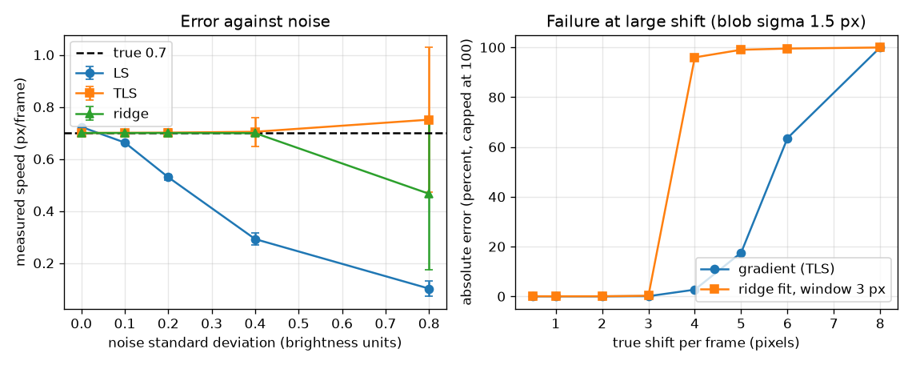
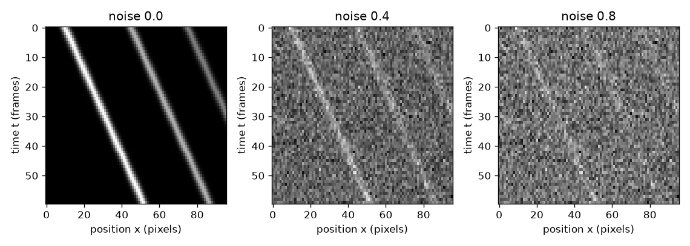

# Session 3: Synthetic kymographs: measure, break and validate

*Level 3 (simulation and validation) · about 90 minutes · openkymo*

> This is a simplified educational model. It is not a validated design tool and must not be used for real structures, electrical installations, vehicles, industrial processes or medical decisions.

**Prerequisites**

- Session 1: kymograph and stripe slope.
- Session 2: structure tensor, units and the shift per frame.

**Learning objectives.** After this session you can:

- Generate synthetic kymographs (blobs, several stripes, a speckled belt) with a known speed.
- Measure speed with two estimators: gradients (LS and TLS) and a ridge tracker with a straight-line fit.
- Measure error and scatter against noise and against speed with a Monte Carlo experiment, and check the line-fit scatter against a formula.
- Predict and observe aliasing: a camera cannot tell a shift d from d minus a wavelength.

## A. Real-world problem
Before you trust a method on a real video you must test it where the answer is known. You build kymographs with a given speed, add noise and measure. Then you ask the engineer's questions: how wrong is the answer when the picture is noisy? At what speed does the method stop working? And when a conveyor belt is filmed with too few frames per second, can we still believe the number the program prints?

## B. Concept and theory
A synthetic kymograph with known speed is the numerical experiment: it is the trusted reference. Estimator 1 uses the gradients. The least-squares (LS) form v = -sum(Kx Kt) / sum(Kx Kx) assumes Kx is exact; noise in Kx makes the denominator too big and pulls the answer towards zero. The total least squares (TLS) form takes the main eigenvector of the structure tensor of Session 2, built from derivative-of-Gaussian images, where the noise in Kx and Kt is equal and independent and only adds the same amount to both diagonal entries, so the eigenvector, and v, are not biased. Estimator 2 follows one stripe: in each row it takes the brightness-weighted centre within a window around the last position, then fits x = x0 + v t by least squares. For n equally spaced points with scatter sigma_x about the line, the standard deviation of the fitted slope is sigma_x * sqrt(12 / (n (n^2 - 1))). Aliasing: if a pattern repeats every wavelength lambda pixels and moves d pixels per frame, frames cannot tell d from d minus k lambda, so the camera reports d folded into the range minus lambda/2 to plus lambda/2. A single smooth blob survives larger shifts than the 1 pixel rule suggests (to about 3 px/frame for a blob of width 1.5 px), but once the shift is a few times the blob width, neighbouring frames no longer overlap and the gradient equation Kt + v Kx = 0 no longer holds.

| Symbol | Meaning | Unit |
|---|---|---|
| K(t, x) | kymograph brightness | brightness units |
| sigma | blob width (standard deviation of the Gaussian) | pixels |
| noise | standard deviation of the noise added to every pixel | brightness units (blob height = 1) |
| sigma_x | scatter of the tracked centres about the fitted line | pixels |
| n | number of points (frames) in the line fit | no unit |
| lambda | wavelength of a periodic pattern | pixels |
| d | true shift between two frames | pixels per frame |

**Assumptions**

- Rigid motion at constant speed, as in Session 2.
- The noise is Gaussian, independent between pixels and equal for all pixels.
- The blob width is 1.5 pixels unless stated; the conveyor speckle has correlation length 1 pixel.
- Synthetic data are a test of the method, not of a real camera: lens distortion, blur from exposure time and rolling shutter are left out.

$$ v_{\mathrm{LS}}=-\frac{\sum K_xK_t}{\sum K_xK_x} $$

$$ \sigma_{v}=\sigma_x\sqrt{\frac{12}{n\,(n^2-1)}} $$

$$ d_{\mathrm{app}}=\left[(d+\lambda/2)\bmod\lambda\right]-\lambda/2 $$

$$ \text{relative error}=\frac{\hat v-v}{v} $$

## C. Visual explanation
The first figure shows the same kymograph of three parallel stripes with no noise, with noise 0.4 and with noise 0.8; the stripes fade into the grain. The second figure has two panels. On the left, the measured speed against noise for LS, TLS and the ridge fit (true speed 0.7, error bars show scatter): LS sinks towards zero, TLS stays at 0.7 but its error bars widen, the ridge fit is very steady until noise 0.4 and loses the stripe at 0.8. On the right, the error against the shift per frame: both methods are exact up to about 3 px/frame, the ridge tracker with a 3 pixel window loses the blob at 4 px/frame, and the gradient method fails from 5 px/frame on.

*Left: measured speed against noise for LS, TLS and the ridge fit. Right: error against shift per frame for the blob.*

*The same three stripes at noise 0, 0.4 and 0.8: the stripes fade into the grain.*

## D. Interactive simulation
Run the lesson (`python start.py 3`), then open the live app: [Session 3: aliasing of a travelling pattern](https://krunalpanchal1995.github.io/openkymo/session-03/) (or `app.html` in this folder). Choose the true shift d and the wavelength of a travelling cosine pattern. The green lines show the stripes as the camera sees them; in the graph view see how the apparent shift jumps whenever d passes half a wavelength.

**Challenge.** Make the camera report the pattern moving backwards (a negative apparent shift) although it really moves forward.

## E. Worked example and experiment
**Problem.** A cosine pattern of wavelength 8 px moves 5 px/frame to the right. What shift does the camera report, and what is the standard deviation of a slope fitted through 60 tracked points with scatter 0.26 px?

1. Apparent shift = 5 folded into -4 .. +4: 5 - 8 = -3 px/frame. The pattern seems to move backwards at 3 px/frame.
2. Check by the program: the gradient estimator on this synthetic pattern reports -2.94, within 0.1 of -3.
3. Slope scatter = 0.26 * sqrt(12 / (60 * (60^2 - 1))) = 0.26 * sqrt(12 / 215 940) = 0.26 * 0.00745 = 0.0019 px/frame.
4. Simulation with 2000 noisy fits gives 0.0019 as well.

**Answer.** The camera reports -3 px/frame (backwards); the fitted slope scatter is 0.0019 px/frame.

**Experiment.** Film a rotating fan or a car wheel with a phone and notice the wagon-wheel effect: the spokes look slow or backwards. That is the same folding formula, with the spoke spacing as the wavelength. Compare the apparent rotation with the formula using the frame rate. Model versus reality: the formula assumes equally spaced frames and a perfectly periodic pattern; real cameras have exposure blur and rolling shutter, which hide or distort part of the effect.

## Real-world application and mini-project: Measure the speed of a conveyor belt from a kymograph
A camera looks along a conveyor belt with a speckled surface. The belt really moves at 0.80 m/s and one camera pixel covers 2 mm. Use `conveyor_kymo` and `belt_speed_mps` from Session 3 to find the smallest frame rate in the list 100, 200, 300, 400, 600, 800 frames per second for which the measured speed is within 2 percent of the truth for every one of 5 different noise seeds (seeds 0 to 4).

**Deliverable:** A script that prints, for each frame rate, the shift per frame in pixels and the worst relative error over the 5 seeds, names the smallest frame rate that passes, and saves a picture of the kymograph at the failing frame rate and at the chosen one. Add one sentence comparing your result with the 0.5 px/frame design rule of Session 2.

**Success looks like:** The smallest passing frame rate is reported (it is 200 fps, a shift of 2 px/frame, worst error 0.1 percent); at 100 fps (4 px/frame) the worst error is about 18.5 percent. The design rule would ask for 800 fps, so the report should say that the rule is conservative for this speckle.

## F. Assessment and design challenge
**Question type A: Conceptual.** Why does noise bias the least-squares speed towards zero, and why does the total least-squares (structure tensor) speed not suffer from this bias?

Hint

Where does noise enter in the formula, and what does equal noise in Kx and Kt do to the matrix J?

Step-by-step solution

In LS the noise adds to sum(Kx Kx) in the denominator but averages out in sum(Kx Kt), so the ratio shrinks and the speed is pulled towards zero (for a true 0.7: 0.723 with no noise, 0.530 at noise 0.2, 0.102 at noise 0.8). With equal independent noise in Kx and Kt, J gets the same amount added to both diagonal entries (J + c I), which changes the eigenvalues but not the eigenvectors, so v = -nt/nx is unchanged. The price: scatter grows with noise (0.278 at noise 0.8).

**Question type B: Numerical.** A ridge tracker gives 40 centre points with scatter 0.3 px about the fitted line. What is the standard deviation of the fitted slope in px/frame, and how large is it relative to a true speed of 0.5 px/frame?

Hint

Use sigma_x * sqrt(12 / (n (n^2 - 1))) with n = 40.

Step-by-step solution

sigma_v = 0.3 * sqrt(12 / (40 * 1599)) = 0.3 * sqrt(1.876e-4) = 0.3 * 0.0137 = 0.0041 px/frame, i.e. 0.8 percent of 0.5. Sanity: more points would give a smaller scatter, roughly as n to the power minus 3/2.

**Question type C: Graph and simulation interpretation.** In the right panel of the error figure, up to which shift per frame are both methods exact for this blob (width 1.5 px), what happens first, and which method fails first?

Hint

Compare the errors in the printed table at 3, 4, 5 and 6 px/frame.

Step-by-step solution

Both are within 0.2 percent up to 3 px/frame. At 4 px/frame the ridge tracker with a 3 pixel window loses the blob (error -96 percent) while the gradient method is still within 2.7 percent. The gradient method degrades from 5 px/frame (17.5 percent) and is 63.6 percent off at 6 px/frame. So the ridge tracker (limited by its window) fails first. The gradient method works much beyond the 1 pixel per frame rule for a smooth blob, but the rule remains the safe design value for sharp features.

**Question type D: Design and optimisation challenge.** Design: a belt moves at 0.8 m/s and each pixel covers 2 mm. From the conveyor experiment (worst error over 5 seeds: 18.5 percent at 100 fps, at most 0.2 percent from 200 fps up) choose a frame rate for production. Justify it and say what you give up.

Hint

Compare the smallest passing rate (error below 2 percent) with the rules of Session 2 and keep a safety margin.

Step-by-step solution

200 fps passes (2 px/frame, error 0.1 percent) but sits just below the failing region (4 px/frame fails with 18.5 percent), so the margin is thin and depends on this speckle size. A production choice is 400 fps (1 px/frame, the hard limit of Session 2) or 800 fps (0.5 px/frame, the design rule). Cost: more light is needed for short exposures, and more data to store and process. Assumption: the speckle and noise level of the test; a real belt with finer texture would fail earlier.

Score yourself with [RUBRIC.md](../../RUBRIC.md). Print the [activity sheet](activity_sheet.md) to work on paper.

## Common misconceptions
| Common misconception | What is actually true |
|---|---|
| The gradient method always has to obey 1 pixel per frame. | The real limit depends on how sharp the pattern is: for a smooth blob it works to about 3 px/frame, a sharp speckle fails near 4. The 0.5 to 1 px/frame rule is the safe design value. |
| More smoothing is always better. | Smoothing reduces the noise but also blurs the stripe and can bias the answer; the filter width must match the stripe width. |
| Aliasing only happens at very high speeds. | It happens whenever the shift per frame reaches half the wavelength of the pattern; a fine pattern aliases at a small speed. |
| A ridge tracker needs no starting guess. | It needs a starting column and a window; if the object moves more than the window per frame, it loses the object silently and returns a wrong, plausible-looking slope. |

## Glossary
- **Monte Carlo**: repeating an experiment many times with different random noise to see the typical error
- **bias**: the average error of an estimator (it is not removed by repeating)
- **scatter**: the standard deviation of repeated results; it measures random error
- **aliasing**: a periodic pattern sampled too coarsely looks like a different, slower or backwards pattern
- **wavelength**: the distance after which a periodic pattern repeats
- **TLS**: total least squares: a fit that allows noise in both variables, here the structure-tensor eigenvector

## Finish
1. Do the three coding tasks in [exercises.md](exercises.md).
2. Run `python start.py 3` again after your changes. It ends with the checkpoint; when it prints `PASS`, you are done. (Checkpoint only: `python start.py check 3`.)

Next: the [roadmap](../../promo/roadmap.md). Session 4 is yours to build.
